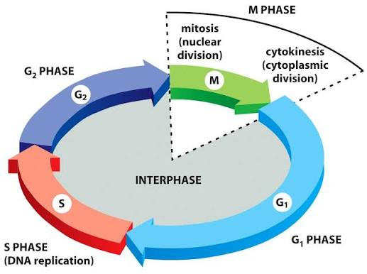
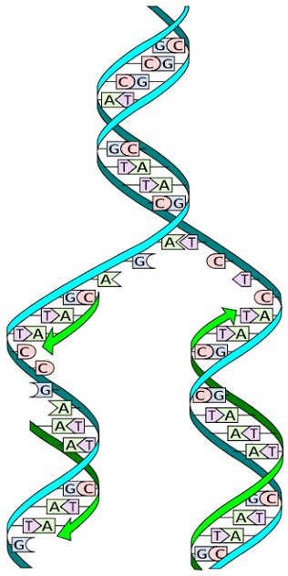

- období života buňky od jejího vzniku až po její rozdělení
- doba mezi 2 děleními buňky
- doba trvání cyklu = generační doba
- zahrnuje růst buňky a jejích složek, dělení jádra a vlastní dělení buňky
- má 2 hlavní fáze - interfáze a buněčné dělení
- buněčné dělení = dělení jádra (karyokineze) a dělení buňky (cytokineze)
- dělení jádra
  - mitóza (dělení somatických buněk)
  - meióza (redukční dělení - vznik gamet)

<Frame>
  
</Frame>

# Fáze

<Steps>
  <Step title="G1 fáze (předsyntetická)">
    - buňka syntetizuje zejména RNA a proteiny a dotváří buněčné organely, buňka roste
  </Step>
  <Step title="S fáze (syntetická)">
    - buňka replikuje DNA, zdvojení sesterských chromozomů
  </Step>
  <Step title="G2 fáze (postsyntetická)">
    - dokončení růstu, příprava buňky na mitózu
  </Step>
  <Step title="M fáze">
    - mitóza, cytokineze
  </Step>
</Steps>

# Buněčné dělení

- rozmnožování buněk (buněčné dělení) - podmínkou pro růst organismu
- z mateřských buněk → dceřinné
- nositelka genetické informace - DNA
- chromozom - 2 stejné molekuly DNA, v každé chromatidě 1 DNA
- chromozomy - uloženy v jádře
- v pohlavních buňkách (gametách) - haploidní počet chromozomů (n) (u člověka 23 chromozomů) - každý chromozom jen jednou
- v somatických (tělních) buňkách - diploidní počet chromozomů (2n) (člověk 46 chromozomů) - každý chromozom ve dvou stejných exemplářích

1. nepřímé dělení = mitóza
   1. počet chromozomů v dceřiné buňce zůstává zachován → vznikají somatické (tělní) buňky
2. redukční dělení = meióza
   1. počet chromozomů se zmenší na polovinu

## Fáze dělení buňky

<Steps>
  <Step title="Karyokineze">
    dělení jádra (mitóza)
  </Step>
  <Step title="Cytokineze">
    dělení cytoplazmy a celé buňky
  </Step>
</Steps>

# Mitóza

## Profáze

- zahuštění chromatinu
- chromozomy se zkracují stávají barvitelonými
- rozpadá se jaderná membrána a mizí jadérko
- u protilehlých pólů buňky vzniká dělící vřeténko (z mikrotubulů cytoskeletu)
- u ŽB se na tvorbě dělícího vřeténka podílí centrozóm

## Metafáze

- chromozomy se soustřeďují do rovníkové (ekvatoriální) roviny
- vlákna dělícího vřeténka se napojují na cetromery chromozomů

## Anafáze

- podélné rozdělení chromozomů na chromatidy
- chromatidy přitahovány k opačným pólům buňky vlákny dělícího vřeténka
- konec anafáze - od středu buňky se začíná tvořit přepážka mezi dceřinými buňkami

## Telofáze

- chromatidy fungují jako chromozomy, ztrácí svoji barvitelnost
- vzniká jaderná membrána
- mizí dělící vřeténko
- v průběhu telofáze se začíná rozdělovat cytoplazma buněčnou stěnou = cytokineze

## Cytokineze

= rozdělení cytoplazmy a vznik 2 nových dceřiných buněk

- u ŽB: na povrchu dělící rýha, začkrcení pomocí stažitelného prstence
- u RB: od středu destička → rezdělení buňky na 2

## Interfáze

- doba, kdy se buňka nedělí
- karyoplazma (plazma jádra) oddělena od cytoplazmy jadernou membránou
- obnova původní stavby chromozomů - zdvojení = replikace DNA (doplní se ta část chromozomu, která přešla při dělení do 2. buňky)

<Frame caption="Dotváření DNA">
  
</Frame>
