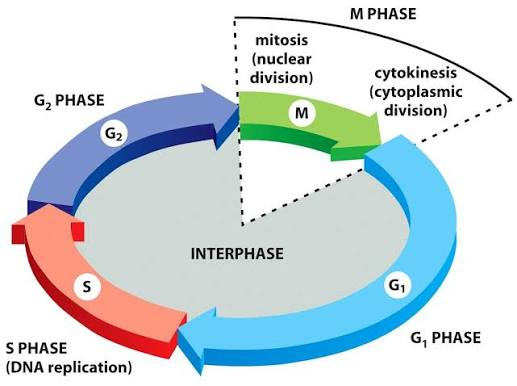
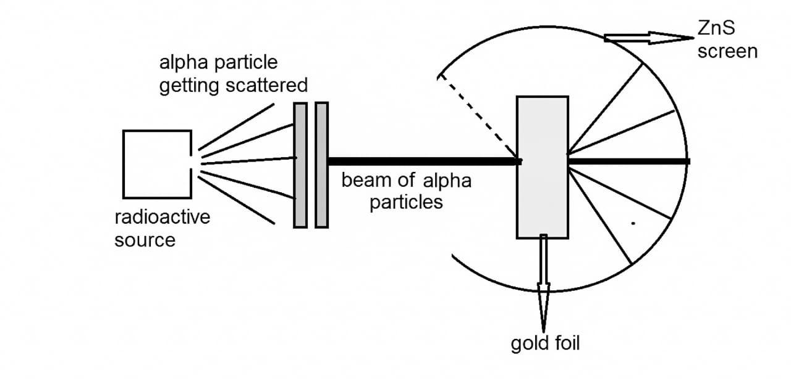

- 1859 - objev katodových paprsků
  - vlastnosti
    - vyletují z kovové elektrody
    - ovlivnitelné elektrickým i magnetickým polem

- 1897 - **Thomson** - Hypotéza o elektronu
  - z neutrálního želena vylétaly záporné elektrony
  - $$\implies$$neutrální atom má uvnitř sebe částice, které jsou záporně nabité (elektrony)
  - **Thomsonův pudinkový model**
    - kladná částice atomu je pudink (rosol - spojitě rozložený), v něm jsou záporné rozinky (elektrony)

- rádi bychom zjistili hmotnost a náboj elektronu
  - z těchto pokusů ovšem určili poměr $$\frac{q}{m}$$ - měrný náboj
- 1910 - Millikan

<Frame>
  
</Frame>

- z rovnováhy $$F_G, F_e$$ se dokáže spočítat elementární náboj

<Card title="Konstanty" type="tip">
  $$e^-=-1{,}602\cdot 10^{-19} \,\mathrm{C} \\ m_e=9{,}1\cdot 10^{-31}\,\mathrm{kg}$$
</Card>

- 1911 - Ernest Rutherford <kbd>[rádzfór]</kbd>
  - pokusy s radioaktivními částicemi

> tenkrát byla radioaktivita strašně modní, asi jako je dneska hubnutí nebo zdravý zdravotní styl

- z jáchymovského smolince vystřelují kladné alpha částice a naráží do ZnS
- ostřeloval Au fólii (extrémně tenké) 

<Frame>
  
</Frame>

- rozměr atomu $$10^{-10} \,\mathrm{m}$$
- roměr jádra $$10^{-15}\,\mathrm{m}$$
- $$e^-$$je 1837x lehčí než proton
- atom - prázdný prostor veškerá hmota je v centru (jádru)
- vznik planetárního modelu
  <Frame>
  </Frame>
