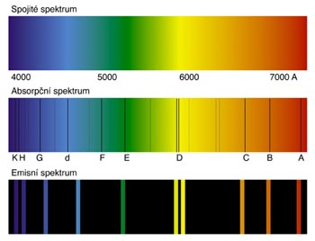

<Card title="Veličiny, …" color="#F43F5E" icon="input-numeric">
  - **spektrum**
    - jak vyzařuje těleso na různých $$\lambda$$
    - světla
      - emisní (e. g. nějaké rozžhavené těleso) - spojitá, čárová
      - absorpční
    - světlo rozložíme pomocí spektroskopu (hranolový/mřížkový)
    - také můžeme dělit na
      - spojitá - rozžhavená tělesa
      - čárová - plyny
      - pásová - složitější molekuly

  <Frame>
    
  </Frame>
</Card>

# Radiometrické veličiny

- používají se i u druhů elektromagnetického záření, kt. nelze vnímat lidským okem
- jsou definovány pro všechny druhy elektromagnetického záření
- odpovídají těmto veličinám fotometickým
  - světelný tok → zářivý tok
  - svítívost → zářivost
  - osvětlení → intenzita ozařování

<Card title="Steradián" type="info">
  Steradián je takový prostorový úhel, že na kouli o poloměru $$r$$ vymezí plochu $$r^2$$.
</Card>

## Zářivý tok $$\Phi _e$$

- představuje energii vyzářenou zdrojem za jednotku času
- určen vztahem $$\Phi _e = \frac{\Delta E}{\Delta t}$$, kde $$\Delta E$$ je energie vyzářená zdrojem za dobu $$\Delta t$$; $$[\Phi _e] = J\cdot s^{-1} = W$$
- ideální bodový zdroj světla vyzařuje zářivý tok rovnoměrně všemi směry, pro reálné zdroje to ale neplatí; často je nutné vědět, jakou energii zdroj vysílá do určité části prostoru
- zavádíme zářivost $$I_e$$

## Zářivost $$I_e$$

- je definována jako podíl zářivého toku $$\Delta \Phi _e$$ a velikosti prostorového úhlu $$\Delta \Omega$$, do kterého je tento tok vyzařovaný:

$$
I_e = \frac{\Delta \Phi _e}{\Delta \Omega}
$$

$$
[I_e] = W \cdot sr^{-1}
$$

## Intenzita vyzařování $$M_e$$

- definována jako podíl zářivého toku $$\Delta \Phi _e$$, který je vysílán z plochy zdroje (resp. dopadá na plochu povrchu tělesa) o plošném obsahu $$\Delta S$$, a tohoto obsahu:

$$
M_e = \frac{\Delta \Phi _e}{\Delta S} \\ [M_e]=W\cdot m^{-2}
$$

# Fotometické veličiny

- historicky starší než veličiny radiometické
- omezeny pouze na záření viditelné lidským okem
- definovány podle citlivosti lidského oka
- závislé na barevném složení zkoumaného záření (lidské oko je nejcitlivější na žlutozelené světlo o vlnové délce 555 nm)
- nemají fyzikální smysl

## Světelný tok $$\Phi$$

- vyjadřuje intenzitu zrakového vjemu normálního oka, vyvolaného energií světelného záření, které projde za jednoku času určitou plochou v prostoru, kterým se světlo šíří POKRAČOVAT ODSUD

<Card title="Absolutně černé těleso" icon="sun-alt">
  - **nic neodráží**, ale může vyzařovat
  - např. hvězdy
</Card>

<Card title="Absolutně bílé těleso" icon="reflect-both">
  - pouze odráží, nic nevyzařuje (ideální kulové zrcadelo o teplotě 0 K)
</Card>

<Card title="Šedé těleso" icon="sparkles">
  - to mezi absolutně bílým a černým tělesem
</Card>

- 1 cd = svítívost absolutně černého tělesa o ploše 1cm2 ve směru kolmém k ploše při teplotě tuhnoucí platiny $$1773\, \mathrm{^{\circ}C}$$ při normálním atmosférickém tlaku
