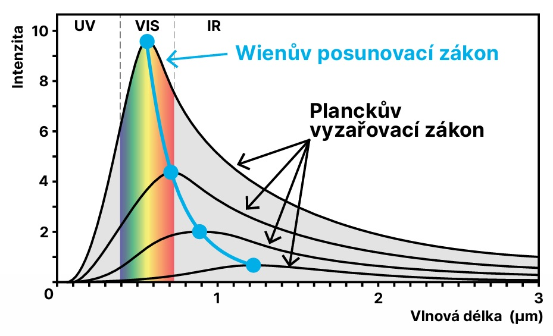

- když roste teplota tak $$\lambda _{\mathrm{max}}$$ klesá
  - tmavě červená → jasně červená → oranžová → bílá → modrobílá

$$
H_{\lambda}=\frac{\Delta M_e}{\Delta \lambda} \\ [H_\lambda] = W \cdot m^{-3}
$$

<Frame>
  
</Frame>

<Frame>
  
</Frame>

$$
\lambda _{\mathrm{max}} \cdot T = b \\ b = 2,9 \cdot 10^{-3}\, \mathrm{m\cdot K} \\ H_\lambda=\frac{dM_e}{d\lambda}
$$

- dřív neuměli matematicky popsat tu křivku

$$
M_e = \int_0^\infty H_\lambda \,d\lambda
$$

- tvar křivky? → Max Planck
  - řekl si, že $$E=hf$$
  - 14. 12. 1900 - kvantová hypotéza
  - záření je vyzařováno a pohlcováno pouze v kvantech

$$
h = 6{,}626\cdot 10^{-34} \mathrm{\,J\cdot s}
$$

$$
H_\lambda = \frac{2\pi hc^2}{\lambda^5}\cdot\frac{1}{e^\frac{hc}{\lambda kT}-1}
$$

- $$k = 1{,}38 \cdot 10^{-23}\,\mathrm{J\cdot K^{-1}}$$ je Boltzmanova konstanta

$$
M_e = \sigma T^4 \\ \sigma = 5{,}67 \cdot 10^{-8}\,\mathrm{ Wm^{-2}K^{-4}}
$$

# Mikrosvět

- rozměry $$10^{-9} \div 10^{-18} \mathrm{\,m}$$
- čas $$10^{-24}\,\mathrm{s}$$
- jiné zákony než v makrosvětě
- z atomistů ve starověkém Řecku (Epikuros, Démokritos, Leukippos)
- čočky, mikroskopy (16. stol.) - mají optické vady
  - rozlišovací schopnost oka je 0,07 mm na vzdálenost 25cm od oka
  - 2000x zvětšení
  - omezeno ohybem světla

    - $$\frac{1}{2}\lambda _{sv}, \frac{\lambda}{2}=200\,\mathrm{nm} = 2 \cdot 10^{-7} \,\mathrm{m}$$
  - lze pozorovat bakteire, ne viry
- poté chemický atomismus v 19. stol.
  - Dalton zjistil, že se chemické látky slučují v určitých hmotnostních poměrech
- za určitých podmínek proud iontů/elektronů vykazuje podobné věci jako světlo

  - elektronové/iontové mikroskopy → převádění pomocí počítačů na viditelné spektrum
  - $$\gamma$$ až 100 000
