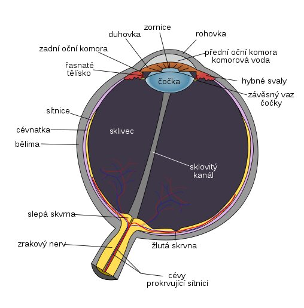

- fyzikálně: optická soustava, která je tvořena různými optickými prvky s různým indexem lomu

<Frame caption="Oko">
  
</Frame>

- akomodace oka - změna ohniskové vzdálenosti čočky
  - ciliární sval - dokáže čočku zplošťovat nebo ztlušťovat (tlustá na blízko - nízké $$f$$, tenká na dálku - vysoké $$f$$)
- u oka určujeme bod, kam nejdále dohlédneme ostře = **daleký bod oka**
  - u zdravého teoreticky v $$\infty$$
- stejně tak určujeme bod, kam nejméně dohlédneme ostře = **blízký bod oka**
  - u zdravého 10-15 cm (je to namáhavé)
- konvenční zraková vzdálenost - ideální vzdálenost blízkého bodu pro nenamáhání oka - 25 cm
