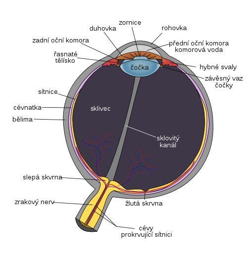

- fyzikálně: optická soustava, která je tvořena různými optickými prvky s různým indexem lomu

<Frame caption="Oko">
  
</Frame>

- akomodace oka - změna ohniskové vzdálenosti čočky
  - ciliární sval - dokáže čočku zplošťovat nebo ztlušťovat (tlustá na blízko - nízké $$f$$, tenká na dálku - vysoké $$f$$)
- u oka určujeme bod, kam nejdále dohlédneme ostře = **daleký bod oka**
  - u zdravého teoreticky v $$\infty$$
- stejně tak určujeme bod, kam nejméně dohlédneme ostře = **blízký bod oka**
  - u zdravého 10-15 cm (je to namáhavé)
- konvenční zraková vzdálenost - ideální vzdálenost blízkého bodu pro nenamáhání oka - 25 cm

# Poruchy zraku

## Krátkozraké oko

- obraz vzniká před sítnicí u dalekého bodu
- oko je moc dlouhé
- korekce rozptylkou

## Dalekozraké oko

- obraz vzniká za sítnicí u blízkého bodu (\< 10 cm)
- oko je moc krátké
- korekce spojkou

## Astigmatismus

- nepravidelný tvar čočky/rohovky → cylindrické čočky na korekci

## Vetchozrakost

- ztráta elasticity - špatné ostření na blízko → bifokální skla

## Šedý zákal

- zahalení čočky

## Zelený zákal

- vysoký vnitřní tlak → poškození nervu

# Podmínky ostrého vidění

- pro zdravé oko se vytvoří ostrý obraz jen v případě, že

1. je předmět dostatečně osvětlen
   1. zornice $$2 \div 8 \mathrm{\, mm}$$, čím menší, tím více světla
2. zrakový vjem trvá dostatečně dlouho
   1. alespoň $$0{,}1 \mathrm{\, s}$$
   2. $$ f > 10 \mathrm{\,Hz}$$ → nerozlišitelné obrazy
3. zorný úhel
