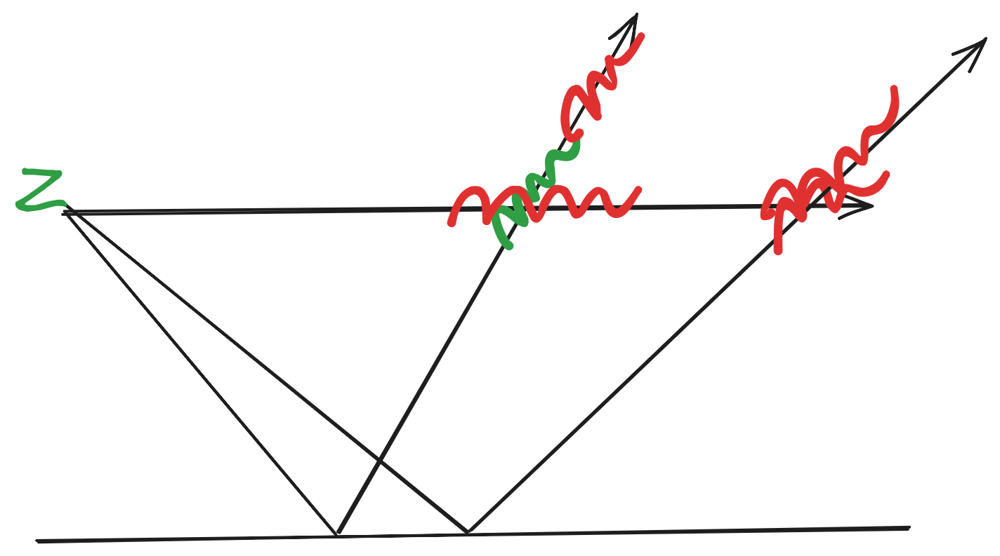
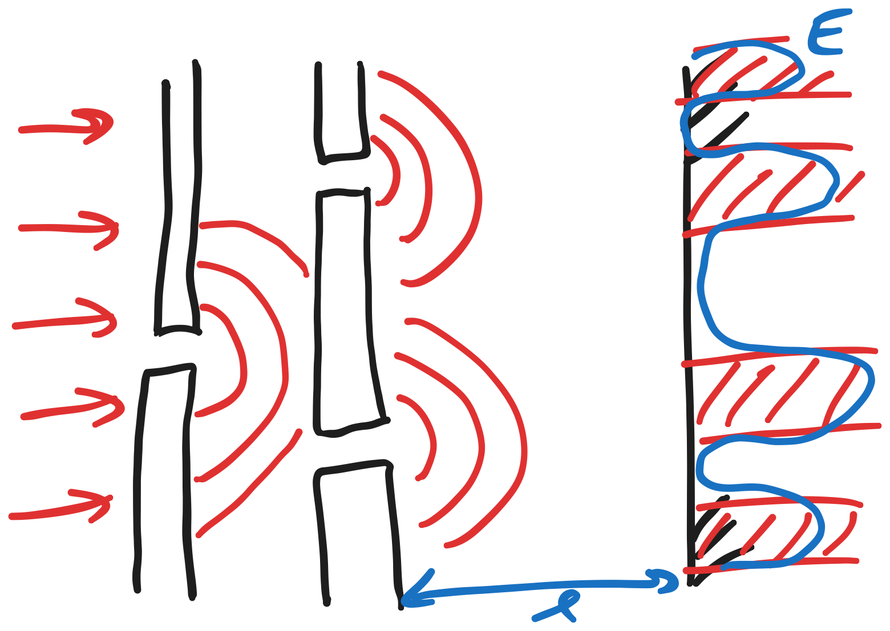

- interference vlnění (světla) - skládání vlnění z různých zdrojů
- v daném místě se sčítají okamžité výchylky kmitání elektrické a magnetické složky: $$\vec{E}\perp\vec{B}$$

$$
\vec{E}=\vec{E_1}+\vec{E_2} \\ \vec{B}=\vec{B_1}+\vec{B_2}
$$

- předpokládáme tzv. **KOHERENCI VLNĚNÍ**

<Card title="Koherence vlnění" icon="sparkles">
  - vlnění jsou koherentní $$\Leftrightarrow$$ mají stejnou frekvenci a stejný fázový rozdíl v daném místě prostoru
</Card>

- světlo z jediného nejlépe monofrekvenčního zdroje rozdělíme na 2 paprsky

<Frame>
  
</Frame>

- $$\Delta d$$- dráhový rozdíl
- běžné zdroje $$\approx 10 \mathrm{\mu m}$$
- u laserů cm až m
- Thomas Young dokázal pomocí interference světla ze 2 zdrojů vlnový charakter světla

<Frame>
  
</Frame>
