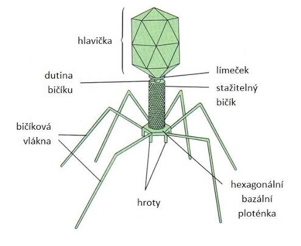

- nebuněčné organismy
- vnitrobuněční parazité
- bez vlastního metabolismu a schopnosti reprodukce
- velikost 15-390nm
- šíření vzduchem - chybí lokomoční orgány
- podstata - holý genetický program v bílkovině (infekční nukleová kyselina)

# Stavba virionu

- virion je jednotlivá částice viru schopná infikovat buňku
- nukleová kyselina - jedna či více molekul DNA nebo RNA
- kapsida - bílkovinný obal chránící nukleovou kyselinu, skládá se z kapsomer
- lipoproteinový obal - přítomen pouze u obalených virů
- receptory a specificita - u neobalených virů určuje specificitu kapsida

# Bakteroifágy

<Frame caption="Bakteriofág">
  
</Frame>

- nejrozšířenější - viry infikující výhradně bakterie
- stavba hlavičky - bílkovinná kapsida s genetickým materiálem
- mechanismus průniku - bičík a vlákna k přichycení, smrštění kontraktilní pochvy
- pravidlo infekce - do buňky proniká pouze nukleová kyselina

# Fáze reprodukce virů

<Steps>
  <Step title="Adsorpce">
    Nabázání virionu na specifický receptor buňky
  </Step>
  <Step title="Penetrace">
    Proniknutí celého virionu nebo jen kyseliny

    - Může po ní nastat lytický (tenhle), nebo lyzogenní cyklus
  </Step>
  <Step title="Eklipsa">
    Uvolnění kyseliny, syntéza bílkovin a replikace
  </Step>
  <Step title="Maturace">
    Zrání nových virionů a tvorba obalu
  </Step>
  <Step title="Eluce">
    Lýza buňky a uvolnění virionu do okolí
  </Step>
</Steps>

## Lytický cyklus

- charakteristický pro virulentní infekce
- rychlé množení a smrt buňky

<Steps>
  <Step title="Infekce">
    Fág vpraví nukleovou kyseliny dovniř hostitele
  </Step>
  <Step title="Destrukce">
    Rozpad hostitelské DNA
  </Step>
  <Step title="Replikace">
    Syntéza nových virových komponent
  </Step>
  <Step title="Sestavení">
    Hromadění stovek nových virů
  </Step>
  <Step title="Lýza">
    Buňka praská (lysozym) a viry se uvolňují do okolí cca 30 minut
  </Step>
</Steps>

## Lyzogenní cyklus

- charaktetistický pro mírné latentní infekce
- virová DNA se skrývá a vyčkává

<Steps>
  <Step title="Integrace">
    Virové DNA se včlení do bakteriálního chromozomu jako tzv. profág (neboli provirus)
  </Step>
  <Step title="Pasivní množení">
    Profág se replikuje spolu s buněčným dělením
  </Step>
  <Step title="Imunita">
    Bakterie je chráněna před infekcí jiným fágem
  </Step>
  <Step title="Indukce">
    Vlivem stresu (např. UV záření)
  </Step>
  <Step title="Zvrat">
    Přechod zpět do lytického cyklu
  </Step>
</Steps>

# Specifické typy virů

## Retroviry

- RNA přepsána do DNA pomocí reverzní transkriptázy

## Proviry

- virový genom uložen v chromozomu hostitele
- způsobuje nádorové transformace

## Onkoviry

- podskupina schopná způsobit nádorový růst u eukaryot

## Viroidy

- nejmenší infekční částice
- infekční RNA bez kapsidy
- napadají rostliny

# Typy virové infekce v buňce

## Latentní infekce

- vir se množí nepatrně
- hostitelské buňce neškodí

## Virogenie

- začlenění genomu do hostitele
- nádorová transformace

## Persistence

- vir pronikne do buňky a převládá v ní bez množení

## Nekrotické ložisko

- lavinové šíření
- hromadění virionů
- buňka praskne
- okolí nakaženo

# Virová onemocnění

- neléčitelná antibiotiky
- lze pouze mírnit příznaky (antivirotika) nebo očkovat

## Rozdělení virů podle hostitele

### Bakteriofágy

- napadají bakterie

### Cyanofágy

- napadají sinice

### Fytoviry

- rostlinné viry (většinou RNA)

### Mykoviry

- napadají houby

### Zooviry

- živočišné viry (DNA i RNA)

# DNA Viry

## Herpesviry

### Opary simplex

- nákaza v dětství slinami
- latence
- probuzení horečkou, stresem

### Plané neštovice

- Varicella zoster
- kapénková infekce, inkubace 12 dní

### Pásový opar

- probuzení latentní infekce planých neštovic stresem

### Infekční mononukleóza

- virus Epsteina-Barrové
- nemoc z líbání
- povlaková angína
- zduřené uzliny

## Poxviry

### Pravé neštovice

- těžké puchýře a krvácení kúže i orgánů
- poslední nákaza v r. 1977

### Myxomatóza

- virové onemocnění postihující králíky

## Papovaviry

### Papillomavirus

- způsobuje bradavice
- může vést k rakovině děložního čípku

## Adenoviry

- záněty dýchacích cest
- záněty očních spojivek

## HepaDNAviry

### Hepatitida B

- přenos krví a pohlavně
- únava, žloutenka
- může způsobit rakovinu jater

# RNA viry

## PikoRNAviry

### Rýma

- zánět nosní sliznice

### Dětská obrna (Poliovirus)

- postižení CNS
- ochrnutí končetin
- vymýcena v Evropě (2002)

### Hepatitida A

- němoc špinavých rukou
- fekálně-orální přenos
- žloutenka

### Slintavka a kulhatka

- infekce u skotu

## Flaviry

### Klíšťová encefalitida

- zánět mozku a míchy

### Hepatitida C

- přenos krví
- nelze očkovat

### Horečka dengue

- přenos komáry
- “horečka lámající kosti”

### Žlutá zimnice

- těžké virové krvácivé onemocnění

## Togaviry

### Zarděnky

- kapénkový přenos
- červená vyrážka
- zduření uzlin na šíji

## Paramyxoviry

### Příušnice

- zduření slinných žláz
- riziko neplodnosti

### Spalničky

- silně infekční virová vyrážka

### Zápal plic

- virová neumonice
- horečka a kašel

## Rabdoviry

### Vzteklina

- smrtelná infekce CNS
- bez pomoci 100% úmrtnost

## Filoviry

### Ebola

- těžká hemoragická horečka
- krvácivé poruchy, čok
- velmi vysoká úmrtnost

## Ortomyxoviry

### Chřipka

- akutní infekce dýchacího ústrojí

## Retroviry a rakovina

### AIDS (HIV)

- syndrom získaného selhání imunity
- napadá T4-lymfocyty
- zhroucení imunitního systému

### T-leukémie

- rakovina vyvolaná retroviry

### Další onkogenního charakteru

- papilomaviry (děložní čípek)
- Epstein-Barr (nosohltan)
- Hepatitida B (jaterní karcinom)
